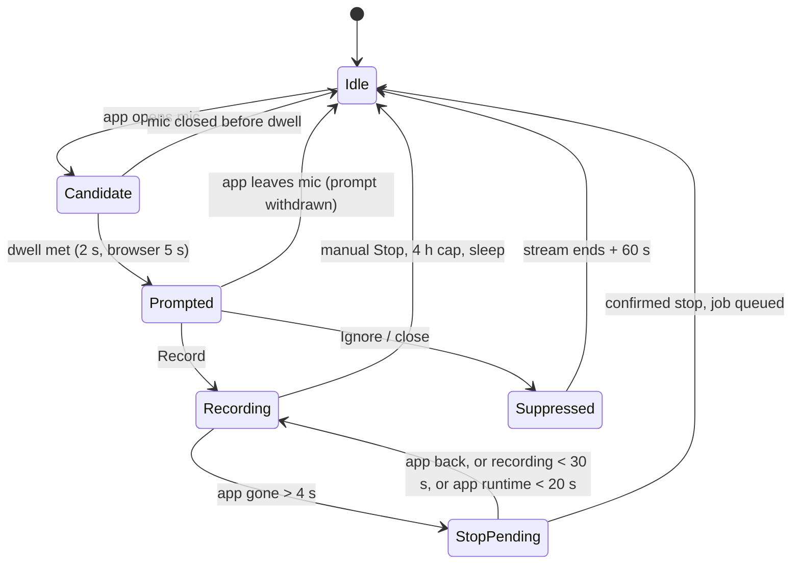

# Wirenote: design and implementation plan

The original build plan (October 2026). The code and `docs/usage.md` are the current truth; this file explains why things are the way they are.

A Python daemon watches PipeWire for apps opening the microphone, prompts with a desktop notification, records mic and system audio as separate tracks, then writes a transcribed, summarized Markdown note. Build starts with a one-day probe (M0) that proves app identification works on your machine; nothing else gets built until it passes.

## Design choices

The core idea is simple: watch which processes hold the mic, match them against an app list, prompt, and stop when the app lets go. The details decide whether it is pleasant to live with.

**Keep:**

- A 4 s disappearance grace. Apps briefly drop and reopen the mic on device switches; without it you get false stops.
- Stop guards: re-check before stopping, and never stop a recording younger than 30 s.
- Dedupe: one prompt per app appearance, never stacked; a cooldown after dismiss.
- A calendar window (starts within 10 min, started up to 5 min ago, or in progress) with a tie-break that falls back to a generic prompt.
- Mic and system audio captured as separate tracks. This is the cheapest speaker split.
- A 5 s capture heartbeat: no audio frames from a track means something broke, so say so.

**Avoid:**

- Prompting on any mic use. A 1 s voice-search blip should not prompt. Add a dwell time.
- Substring app matching. Use exact rules on several properties.
- A fixed allow-list. Make it a config file, so Discord, Signal or WhatsApp can be added.
- Self-exclusion by omission. Exclude our own recorder by PID and stream name instead.
- Handling only the first new app per event. Track each app separately.

Every number here is a starting default, not a fact, to be tuned from the logs in M1.

## Architecture

One Python process with two halves: a live path that must react within seconds, and a processing pipeline that can take minutes after the call.

The detector only reads PipeWire; it never touches audio. Recording starts only after you click Record, and processing never starts until a recording has closed.

## Detection on PipeWire

On Linux, "processes using the mic" means the set of PipeWire nodes with `media.class = Stream/Input/Audio` in state `running`. Detection is easy; knowing which app owns a stream is the hard part, so identity resolution gets most of the code.

**Event source**

1. Primary backend: run `pw-dump --monitor` as a child process and keep an in-memory mirror of nodes and links from its JSON updates.
2. Safety net: a 1 s reconcile that rebuilds the running-capture set from the mirror. This catches missed events.
3. Fallback backend for plain PulseAudio: `pactl subscribe` for change events, then `pactl list source-outputs` to read state. Same interface, so the state machine never knows which one is running.
4. Confirm the exact `pw-dump --monitor` output format (especially how removed objects appear) during M0, from real captures, before writing the parser.

**What counts as a mic stream**

- `media.class` is `Stream/Input/Audio` and the node state is `running`, not `idle` or `suspended`.
- Its input is linked to a capture device (`Audio/Source`, including virtual sources like echo-cancel). Streams fed only from a sink monitor are screen recorders or your own system-audio capture, not calls.
- Not your own process: drop streams whose `application.process.id` is the daemon's PID or whose `node.name` carries your recorder prefix. Do not rely on leaving it out of an allow-list.
- Key streams by `object.serial`, never by node id: PipeWire reuses ids (M0). Keep state **per app, not per stream**. An app is on the mic while any of its streams runs, because Chrome opens a second stream during mute and reopens the stream at Join.

**Identifying the app**

**Which PID (from M0).** Process properties live on the stream's Client object.
- For pulse-protocol clients (`client.api = pipewire-pulse`, which covers browsers and Electron apps), `pipewire.sec.pid` is the pipewire-pulse server, so use the self-reported `application.process.id`.
- For native clients, use `pipewire.sec.pid`.
- Check the PID: its exe or comm must equal `application.process.binary`. If the check fails (say a Flatpak sandbox PID), skip every PID-based step below.

Resolve each stream's PID through these sources, most reliable first. Stop at the first rule match.

| Order | Source | Why it matters |
| --- | --- | --- |
| 1 | `/proc/<pid>/cgroup` → Flatpak app ID (`app-flatpak-<id>-…`) or Snap name (`snap.<name>.…`) | Sandboxed apps often report a generic binary such as `bwrap` |
| 2 | `pipewire.access.portal.app_id` | Set when the stream came through the portal |
| 3 | `/proc/<pid>/exe` basename, then `cmdline` | Electron apps (Slack, Teams for Linux, Discord) often call themselves "Chromium" in stream properties; the executable does not lie |
| 4 | Parent PIDs, walked up to 5 levels | Browsers capture from a helper or audio process; the parent is the browser |
| 5 | `application.process.binary`, then `application.name` | Last resort; least reliable |

**Matching rules**

Apps live in `apps.toml`, not in code. Each rule has a canonical key, a kind (`meeting`, `browser` or `ignore`), and exact matches against any of: Flatpak ID, Snap name, executable name, binary name. No substring matching. The file is seeded with the apps actually in use: Chrome (exe `chrome`) and Firefox (exe `firefox-bin`), both verified in M0, Brave (exe `brave`, a native install that behaves like Chrome), verified from the M1 log, plus Discord and Rocket.Chat (Flatpak IDs), which are unverified and to be confirmed from the detector log.

**Browsers**

Browsers are the **main path**: most calls are Jitsi in Chrome. A browser using the mic might be a call, or might be voice search.
- **Title patterns.** A browser rule can carry regexes on the stream's `media.name`. Firefox sets it to the page title (`<room> | Jitsi Meet`), so a Firefox Jitsi call identifies itself and is treated as a meeting.
- **Chrome** always reports `RecordStream`, so it gets the stricter treatment: a longer dwell before prompting, and (in M4) a confidence boost when a calendar event with a meeting link is in its window.
- **Window titles** are not used. This machine runs KDE Plasma on Wayland, which has no standard API for them; a KWin script would be the only route. The daemon must work without them.

## State machine

Each allowed app gets its own state, so a Slack huddle and a Meet tab never block each other; only one recording runs at a time.

Not drawn: if the app leaves the mic while the prompt is showing, the prompt is withdrawn and the app returns to Idle. Manual Stop, the 4 h cap and system sleep all end a recording directly. On wake, the current mic users are recorded as already seen, so nothing prompts.

## Defaults

Every value below lives in `config.toml`. Values marked as a guess are to be tuned from M1 logs.

| Parameter | Value | Reason |
| --- | --- | --- |
| Change detection | PipeWire events + 1 s reconcile | Events are cheaper; the reconcile catches misses |
| Disappearance grace | 4 s | Hides mic reopen on device switch |
| Dwell before prompt, meeting app | 2 s | Stops one-second blips from prompting |
| Dwell before prompt, browser | 5 s | Voice search and dictation are short; calls are not |
| After dismiss | Silent until that app's stream ends, then 60 s | An ignored call should stay ignored |
| Min app runtime before auto-stop | 20 s (guess) | Tune in M1 |
| Min recording age before auto-stop | 30 s | Prevents stop right after start |
| Capture heartbeat | 5 s per track | No frames means a broken track; notify |
| Audio format | 16 kHz mono 16-bit, one file per track | Whisper's native rate, half the disk |
| Max recording length | 4 h hard stop | Protects disk if stop detection fails |
| Calendar window | starts in ≤10 min, started ≤5 min ago, or in progress | Simple and predictable |
| Calendar refresh | every 5 min | ICS polling is enough |
| Opt-out nudge | 5 dismisses of one app → offer to set it to `ignore` | Per app, not global |
| Sleep and wake | pause, close prompt, reseed on resume with no prompt | Waking with Zoom open must not prompt |
| Tray icon | on where the desktop hosts one (an `org.kde.StatusNotifierWatcher`); none elsewhere | The state and Stop one click away; detection never depends on it |
| Update check | off; when on, once a day | Nothing leaves the computer unless asked; releases are rarer than daily |
| Update notification | once per version, never while recording | A reminder, not a nag; never during a call |
| Waiting for a call before updating | at most 4 h, the recording cap | An update must not end a recording |
| Speech engine | `auto`: Parakeet when it knows the language (setting or locale), no vocabulary is set and the Whisper model is the default; else Whisper | Parakeet is several times faster on a CPU; Whisper covers every other case |
| Speech pieces for Parakeet and whisper.cpp | at most 30 s, 0.2 s padding | Parakeet is trained on short audio; padding keeps word edges |
| Parakeet batch | 1 piece | Batches of 8 peaked at 3.0 GB on a 30-min call and were slower; one at a time stays at 1.4 GB |
| whisper.cpp model | `ggml-large-v3-turbo-q5_0.bin` | Same model as the Whisper default, quantized for the GPU |
| whisper.cpp time limit | 3 s per second of speech, at least 10 min | A `whisper-cli` stuck on a GPU driver must not hold up later notes; a slow CPU build stays inside |
| Flagged moments | a flag within 2 s of the last one is dropped | A double press must not store two |
| Flag window | 30 s before and 10 s after each flag | People flag just after hearing something; the summary prompt gets the lines in the window, at most 3000 characters, an equal share per flag with the words nearest it first, and at least 40 characters of text each; when that many flags do not fit, an even spread of them in time does. Each part of a long call gets only its own flags |
| Flag a finished call | at most 24 h into it, and no later than its end when its length is known | Nothing is recorded that long (the cap is 4 h); a flag after the end is about the end |
| Flag in the note | the line closest to each flag, no model; a line longer than the flag window is cut to it, by time in proportion to its characters, at word boundaries; a word longer than the window, as in a script written without spaces, is cut between characters | The same list every time; one speaker can make a paragraph minutes long; the app shows the same excerpt with jump links |
| Live transcript | off | It uses CPU during the call |
| Live engine | Parakeet where it knows the language, else Whisper `small`; downloaded models only; 2 threads | Fast enough to keep up; never a download during a call |
| Live pieces | read every 1.5 s; cut after 0.5 s of silence (at least 2 s) or at 15 s | Whole sentences, a few seconds behind |
| Live echo check | a mic line waits at most 10 s for the system track | The far side's voice in the mic is dropped, as in the note |
| Import size | up to 4 GB | Several hours of video; the upload is streamed to disk, never held in memory |
| Import length | the first 4 h | The same cap as a recording |
| Import conversion | ffmpeg, at most 30 min | A 4 h video converts in a few minutes; a stuck ffmpeg must not block the app |
| OpenAI-compatible API | `https://openrouter.ai/api/v1`, model `anthropic/claude-sonnet-5.5` | One key reaches most models; Sonnet summarizes well at half the price of Opus |
| API on another computer | https only; a confirmation per destination host | The key and transcript never travel in clear; a new host is a new place your calls go |
| API on this computer | counts as local: owner check, no key, Ollama's Ask budget | Same as Ollama |
| Shortest speaker | 8 s of speech in the whole call; less joins the speaker heard nearest in time | A laugh or a word through a bad line was split off as its own speaker; on a 30-min call with three people, five of seven speakers had 9 s together |
| Summary template | `general`; picked per call: the one you chose, the one kept for its calendar series, a whole-word match of the meeting title, a call-app match, the default | A standup, an interview and a lecture need different sections; the title only selects, it is never part of the instructions |
| Template files | at most 6 sections, 2000 characters of instructions, a section key of `a-z`, `0-9`, `_` (32 at most), 64 KB per file | A summary request stays small and a bad file is skipped, not guessed at |
| Summary memory | wait until free RAM plus free swap holds the Ollama model's file + 1 GB; check every 15 s, at most 5 min | Loading without room gets Ollama or another program killed |
| Summary passing failure | ask again once after 30 s; then write the note and queue the summary again after 60 s, up to 3 attempts | Ollama restarts in seconds and memory frees up; the transcript is never held back |

## Prompt, capture and processing

Detection decides when; these three parts decide whether the output is worth reading. Capture is where most real bugs will come from.

**Prompt**

- Send a desktop notification over D-Bus (`org.freedesktop.Notifications`) with two actions: Record and Ignore. Title is the calendar event name, else "Zoom is using your mic".
- Set it to not expire, and treat a close without an action as Ignore.
- Check the server's capabilities first. If it has no action support (some minimal notification daemons), show a plain notification and rely on the `record` CLI command or a keyboard shortcut.
- While recording, keep a persistent "Recording" notification with a Stop action. Optionally copy a consent line to the clipboard when recording starts.

**Capture**

- Two `pw-record` processes, one file per track, 16 kHz mono 16-bit.
- Mic track: record from the same source node the meeting app is linked to, not blindly the default. If you picked a headset in Zoom, you record the headset.
- System track: capture the default sink's monitor (`stream.capture.sink=true`). If the default sink changes mid-call, start a new segment on the new sink; processing stitches segments by timestamp.
- Tag both streams with a `node.name` prefix so detection ignores them.
- Stop with SIGINT so files close cleanly. On startup, find unfinished recordings and repair their headers.
- Heartbeat: if a track's file stops growing for 5 s, notify and keep the other track running.
- Echo: without headphones, your mic also hears the other side, which shows up as duplicate lines under "Me". Offer PipeWire's echo-cancel source as the mic, and drop "Me" segments that closely match an overlapping "Others" segment.

**Processing** (a queued job stored in SQLite, so a crash never loses a meeting)

1. Transcribe each track with faster-whisper: voice-activity filter on, word timestamps, language auto-detect. Model is configurable: a small model on CPU by default, a large one when a GPU is present.
2. Merge both tracks by timestamp into one transcript labelled "Me" and "Others". Splitting "Others" into individual speakers is out of scope for v1.
3. Summarize through a pluggable backend: Ollama locally, or an API key. Output a summary, decisions, action items with owners, and open questions. Long calls are summarized in chunks of about 15 min, then combined.
4. Write a Markdown note with frontmatter (title, date, app, duration, calendar event, audio paths) to `~/Meetings/YYYY/MM/`. Delete audio after 30 days by default.
5. CLI: `status`, `record`, `stop`, `reprocess <id>`, `doctor`, and `dump-streams` for capturing test fixtures.

Export to other note apps is a later add-on; Markdown first.

## Milestones

About 10 working days of build plus one week of living with the detector before recording is added. Each milestone ends with a test you can fail; do not start the next until it passes.

1. **M0 — Stream probe (1 day).** A throwaway script that dumps PipeWire state. Join a Jitsi call (public `meet.jit.si`) in the browser used daily for Jitsi and in the other browser, plus a Discord call and a Rocket.Chat call, and save each capture as a test fixture. Zoom, Teams and Slack are dropped because they are not used.
   - Exit: the Jitsi browser, the other browser, Discord and Rocket.Chat each resolve correctly through the lookup order in Detection; the two Flatpaks (Discord, Rocket.Chat) resolve to distinct identities; and the `pw-dump --monitor` format is written down.
   - If the two Electron Flatpaks cannot be told apart, stop here and rethink identity before writing anything else.
2. **M1 — Detector and prompt, no recording (2–3 days).** State machine, `apps.toml`, notifications, a log line for every candidate, prompt and dismiss. Unit-test the state machine by replaying M0 fixtures against a fake clock.
   - Exit: one week of daily use with zero missed calls and at most one false prompt a day. Tune the defaults from the logs.
3. **M2 — Capture (2 days).** Two-track recording, auto-stop, heartbeat, crash recovery.
   - Exit: 10 real calls with both tracks present, recording stops within 10 s of leaving, and a `kill -9` mid-call leaves recoverable files.
4. **M3 — Transcript (2 days).** faster-whisper per track, merge, echo dedupe, Markdown note.
   - Exit: you can read a 30-minute call's transcript without wincing, and duplicate "Me" lines are rare without headphones.
5. **M4 — Summary and calendar (2 days).** LLM backend, chunked summaries, ICS calendar matching.
   - Exit: calendar-backed calls get the right title, and summaries list action items you actually agreed to.
6. **M5 — Packaging (1 day).** `pipx` install, systemd user service, `doctor` command, README with troubleshooting.
   - Exit: a clean install on a second machine or VM works in under 10 minutes.

## Risks

The biggest risk is not technical: Linux audio setups vary so much that what works on your laptop may fail on the next one. Test on a second distro before calling anything done.

| Risk | Likelihood | Fallback |
| --- | --- | --- |
| Electron apps all look like "Chromium" | High | Resolve by executable and cgroup (Detection table); M0 decides |
| Browser prompts for non-meeting mic use | High | Longer dwell, calendar boost, `ignore` after repeated dismisses |
| No window titles on GNOME Wayland | Certain | Do not depend on them; calendar is the main extra signal |
| Mic track contains the other side (no headphones) | High | Echo-cancel source plus duplicate removal |
| Default output changes mid-call | Medium | New system-audio segment on change, stitched by timestamp |
| Notification server lacks action buttons | Low | Plain notification plus CLI or keyboard shortcut |
| Plain PulseAudio, no PipeWire | Low | `pactl` backend behind the same interface |
| Flatpak apps report the sandbox launcher as their binary | Medium | Read the Flatpak ID from cgroup or portal properties |
| Transcription too slow on CPU for long calls | Medium | Smaller model by default; transcription runs after the call, not live |
| Recording people without telling them | Your problem, legally | Persistent indicator, consent line, and know your local recording laws (Germany requires consent of all parties) |
